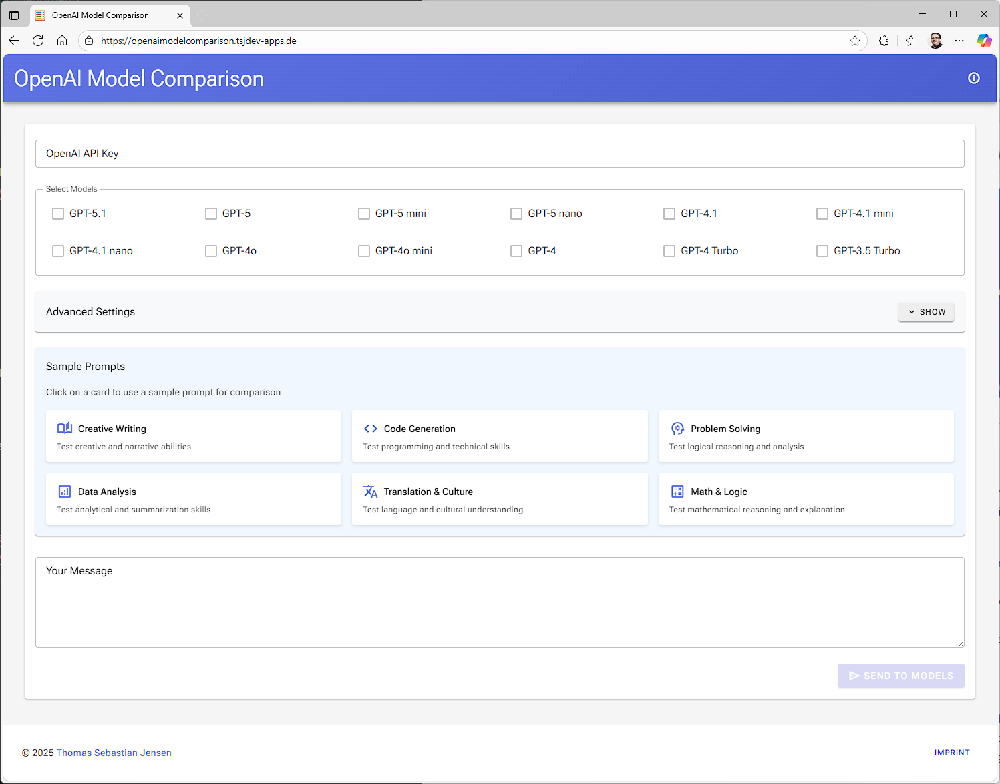
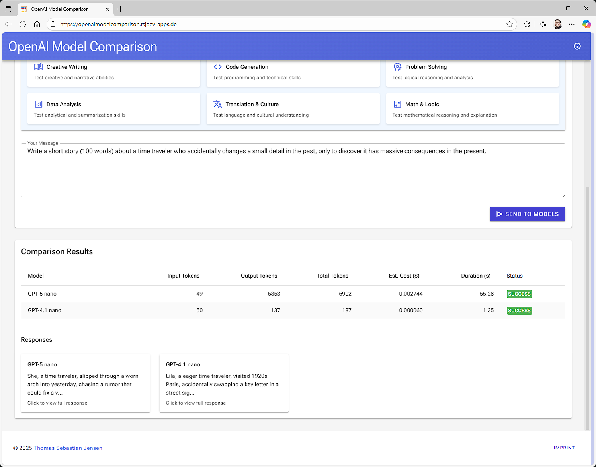
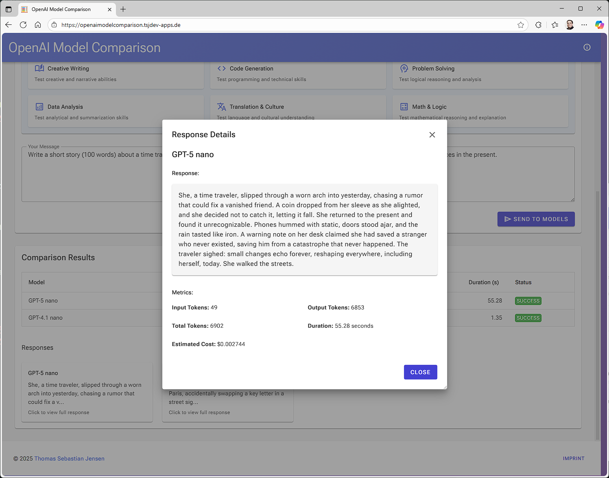

# OpenAI Model Comparison

[](https://openaimodelcomparison.tsjdev-apps.de)
[](https://dotnet.microsoft.com/)
[](https://dotnet.microsoft.com/apps/aspnet/web-apps/blazor)

A modern Blazor web application for comparing responses from multiple OpenAI models side-by-side. Send the same prompt to different models and analyze their responses, token usage, latency, and estimated costs in real-time.

## 🌟 Features

- **Multi-Model Comparison**: Compare responses from multiple OpenAI models simultaneously (GPT-5.1, GPT-5, GPT-4.1, and their variants)
- **Real-Time Analysis**: Track token usage (input/output), response latency, and estimated costs per model
- **Interactive UI**: Modern, responsive interface built with Blazor Server and Radzen components
- **Sample Prompts**: Pre-configured sample prompts for quick testing
- **Advanced Settings**: Configure temperature, max tokens, top-p, frequency penalty, and presence penalty
- **Detailed Response View**: Expand individual responses for detailed analysis
- **Cost Estimation**: Automatic cost calculation based on current token pricing

## 🌐 Live Demo

Try the application now: **[https://openaimodelcomparison.tsjdev-apps.de](https://openaimodelcomparison.tsjdev-apps.de)**

> ⚠️ **Note**: You'll need your own OpenAI API key to use the application.

## 📋 Prerequisites

- [.NET 10.0 SDK](https://dotnet.microsoft.com/download/dotnet/10.0) or later
- [OpenAI API Key](https://platform.openai.com/)
- [Visual Studio 2026](https://visualstudio.microsoft.com/) or [VS Code](https://code.visualstudio.com/)

## 🚀 Getting Started

### Installation

1. Clone the repository:

   ```bash
   git clone https://github.com/tsjdev-apps/openai-model-comparison.git
   cd openai-model-comparison
   ```

2. Restore dependencies:

   ```bash
   dotnet restore
   ```

3. Run the application:

   ```bash
   cd src/OpenAIModelComparison
   dotnet run
   ```

4. Open your browser and navigate to `https://localhost:5001` (or the URL shown in the console)

### Configuration

The application uses the OpenAI API. You'll need to provide your API key through the web interface when using the application.

Available models are configured in `wwwroot/data/models.json` and can be customized with pricing information.

## 🎯 Usage

1. **Enter API Key**: Paste your OpenAI API key in the designated field
2. **Select Models**: Choose which models you want to compare
3. **Enter Prompt**: Type your prompt or select from sample prompts
4. **Configure Settings** (optional): Adjust temperature, max tokens, and other parameters
5. **Compare**: Click "SEND TO MODELS" to send the prompt to all selected models
6. **Analyze Results**: Review responses, token usage, latency, and costs for each model

## 🏗️ Project Structure

```plaintext
src/OpenAIModelComparison/
├── Components/
│   ├── Dialogs/         # Dialog components (Info, Imprint, Response Details)
│   ├── Layout/          # Layout components (MainLayout, ReconnectModal)
│   └── Pages/           # Page components (Home)
├── Models/              # Data models (OpenAIModel, ChatSettings, etc.)
├── Services/            # Business logic services
│   ├── IOpenAIComparisonService.cs
│   ├── OpenAIComparisonService.cs
│   ├── IModelConfigurationService.cs
│   ├── ModelConfigurationService.cs
│   ├── ISamplePromptService.cs
│   └── SamplePromptService.cs
├── wwwroot/
│   └── data/            # JSON configuration files
│       ├── models.json
│       └── sampleprompts.json
└── Program.cs           # Application entry point
```

## 🛠️ Technologies

- **Framework**: .NET 10.0, Blazor Server
- **UI Components**: [Radzen Blazor Components](https://blazor.radzen.com/)
- **OpenAI SDK**: [Azure.AI.OpenAI](https://www.nuget.org/packages/Azure.AI.OpenAI/)
- **Deployment**: Azure Web Apps

## 📸 Screenshots







## 🤝 Contributing

Contributions are welcome! Please feel free to submit a Pull Request.

## 📄 License

This project is licensed under the MIT License - see the [LICENSE](LICENSE) file for details.

## 🙏 Acknowledgments

- Built with [Radzen Blazor Components](https://blazor.radzen.com/)
- Powered by [OpenAI API](https://openai.com/)
